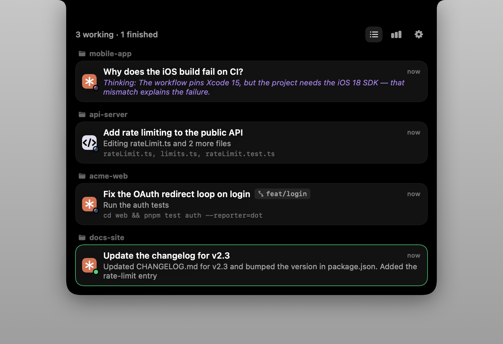
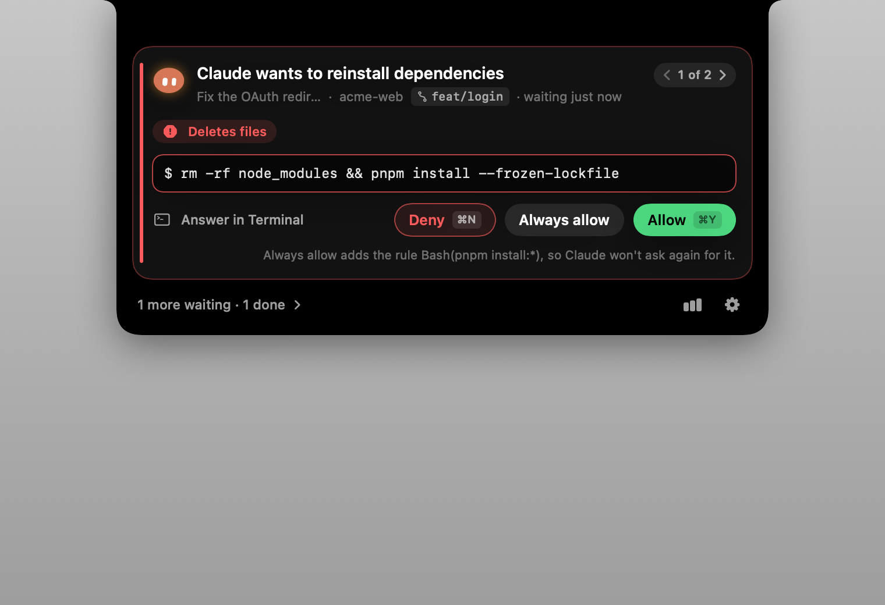
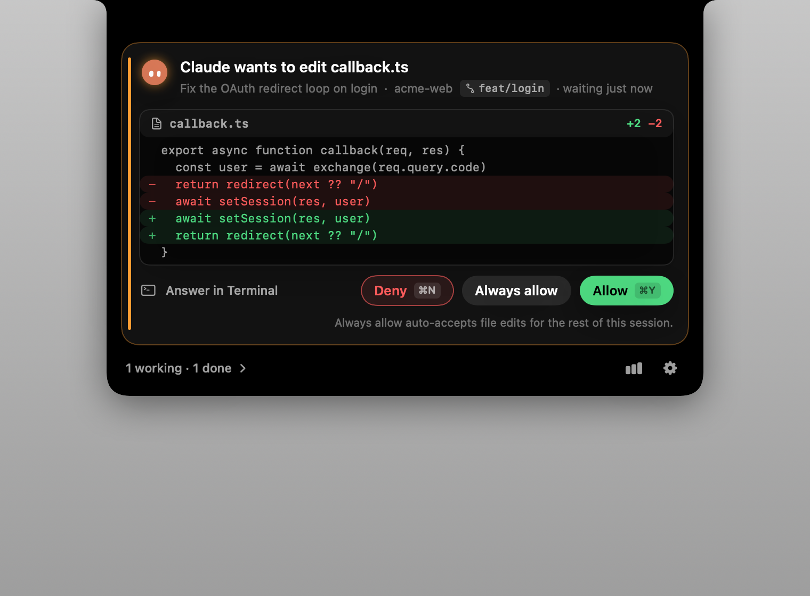
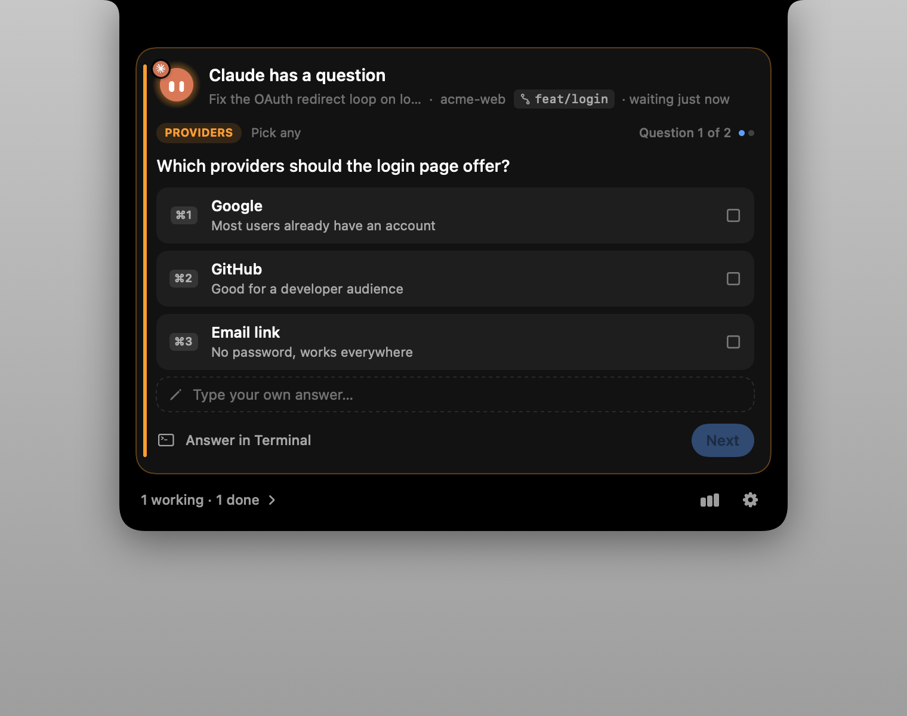
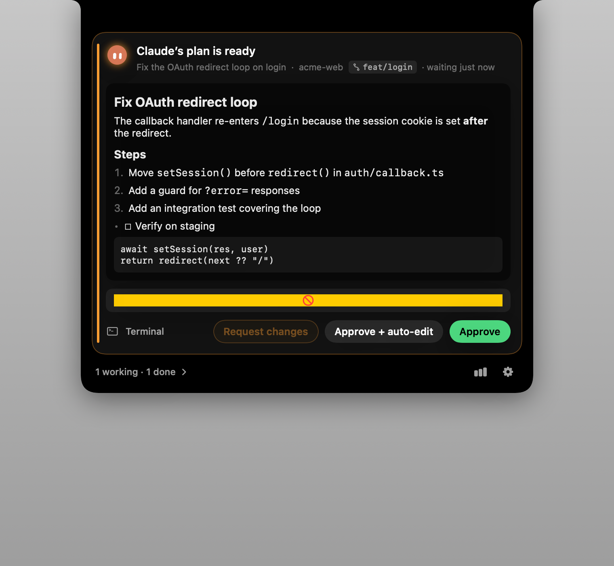
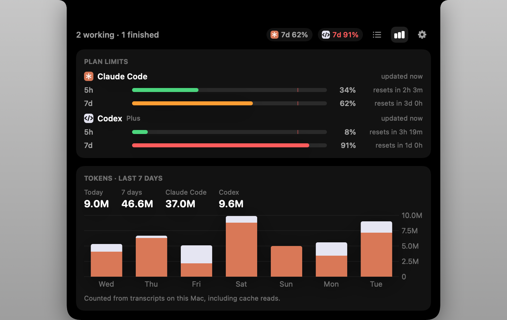

# Orby

A Dynamic Island for your AI coding agents. Orby lives in the MacBook notch (or a
floating bar on Macs without one) and shows what Claude Code, Codex, OpenCode, Qwen Code, Command Code,
Pi, Antigravity and Cursor are doing. You can
approve tool calls, answer questions, review plans and jump back to the right terminal tab
without leaving what you're doing.

Native Swift (AppKit + SwiftUI), ~2 MB, no accounts, nothing leaves your Mac except the
optional Claude plan-limit request (and, if you turn it on, the quota check agy itself makes for
`agy /usage`).



| Permission | Edit | Question | Plan | Usage |
|---|---|---|---|---|
|  |  |  |  |  |

## Features

- **Live sessions**: thinking / working / needs you / finished (thinking shows the latest reasoning line when the transcript has it, and the notch orb ponders with a thought bubble), current tool, last reply, context-window %, subagents,
  grouped by project with git branch and worktree.
- **Approvals from the notch**: Allow (⌘Y), Deny (⌘N), Always allow (Claude's own suggested rule),
  or hand it back to the terminal.
- **Questions**: answer `AskUserQuestion` prompts: single or multi-select, several questions, free text.
- **Plan review**: Markdown-rendered plan with Approve, Approve + auto-accept edits, or send feedback.
- **Jump back**: click a session to focus its iTerm2 session, Terminal.app tab (by tty), tmux pane,
  Kitty/WezTerm pane, or the VS Code / Cursor / Windsurf / Zed window holding the project.
- **Sounds**: synthesized 8-bit cues, macOS sounds, or your own folder of sounds; per-event toggles.
- **Usage**: Codex 5h/weekly limits (from local logs), Claude 5h/weekly limits (opt-in), Antigravity
  5h/weekly limits per model group with the plan tier, and a 7-day token chart stacked per agent
  for Claude Code, Codex, OpenCode, Antigravity, Qwen Code, Pi and Command Code, read-only from
  their local transcripts and databases. The header shows the two limits closest to running out, or up to three you pick in Settings → Usage.
  Antigravity limits come from two opt-in sources, both off by default:
  - **Status line relay** (Settings → Integrations → Antigravity): Orby sets agy's `statusLine` in
    `~/.gemini/antigravity-cli/settings.json` to `orby-bridge --statusline`. That command passes
    agy's quota to Orby over the local socket and prints your previous status line command's
    output, or a short `model · Gemini 7d 94% left` line if you had none. Turning it off puts your
    old `statusLine` back exactly. No network.
  - **`agy /usage`** (Settings → Usage): every 5 minutes, and when you open the Usage tab, Orby runs
    `agy -p "/usage" --output-format json` (20 s timeout, no shell, stdin closed). agy ≥ 1.1.11
    answers it without a model turn, so it spends no quota and saves no conversation, but agy
    does ask Google with your own sign-in.

  The newest reading wins per bucket. A window whose reset time has passed is dimmed until the
  next reading.
- **Polite**: never steals focus, stays quiet when you're already looking at that terminal,
  removes sessions whose process exited.

See [docs/FEATURES.md](docs/FEATURES.md) for a full comparison with Vibe Island and AgentNotch.

## Build & run

Requires macOS 14+ and Xcode 16+ (Swift 6 toolchain).

```bash
scripts/build-app.sh --open     # builds build/Orby.app and launches it
scripts/make-dmg.sh 0.1.0       # packs it into build/release/Orby-0.1.0.dmg
swift test                      # unit + bridge↔socket end-to-end tests
```

Then open **Settings → Integrations** and click **Connect** for each agent you use.
Restart running agent sessions so they load the new hooks.

| Agent | What Orby writes | From the notch |
|---|---|---|
| Claude Code | hooks in `~/.claude/settings.json` | status, approvals, questions, plans |
| Codex | hooks in `~/.codex/hooks.json` | status, approvals |
| Qwen Code | hooks in `~/.qwen/settings.json` (same format as Claude's) | status, approvals |
| OpenCode | plugin `~/.config/opencode/plugins/orby.js` | status, approvals, questions |
| Command Code | hooks in `~/.commandcode/settings.json` + mod `~/.commandcode/mods/orby.ts` | status, approvals |
| Pi | extension `~/.pi/agent/extensions/orby.ts` | status (Pi doesn't ask before running tools) |
| Antigravity | an `orby` entry in `~/.gemini/config/hooks.json` | status, prompt alerts |
| Cursor | nothing: it already runs the Claude Code hooks | status |

- Codex asks you to trust new hooks once: run `/hooks` inside Codex and trust Orby.
- Antigravity (app, IDE and CLI) keeps its own approval prompts; the notch alerts you and can type
  the answer into its terminal.
- OpenCode: restart it to load the plugin. Orby answers through OpenCode's own reply API, so the
  TUI prompt closes when you decide in the notch, and answering in the TUI clears the notch.
  The plugin targets OpenCode 1.x; 2.x uses a different plugin API that isn't supported yet.
- Command Code: approvals go through its Mods API, which Command Code marks experimental. While the
  notch shows a request, Command Code's own prompt waits; pick **Answer in Terminal** to get it back.
- Pi: run `/reload` or restart Pi to load the extension.
- Cursor (IDE and `agent` CLI) runs the hooks in `~/.claude/settings.json` by default, so its sessions
  appear as Cursor once Claude Code is connected. It sends no permission events to those hooks.
- Plugin files carry an `orby-bridge` header. Orby only rewrites or removes files with that header,
  and backs them up to `~/.orby/backups/` first.
- Upgrading from NotchIsland: the first launch moves `~/.notchisland` to `~/.orby`, keeps your
  settings and rewrites the old hooks (backups in `~/.orby/backups/`). Restart running agent sessions.
- If another notch app (e.g. Vibe Island) is also hooked into the same agent, both get every
  permission request. Disable one of them to avoid double prompts.

Render the UI states to PNG without Screen Recording permission:

```bash
.build/debug/Orby --render-previews docs/screenshots
```

## How it works

```
claude / codex / qwen / commandcode / antigravity       opencode / pi / commandcode
  └─ hook (settings.json / hooks.json)                    └─ JS/TS plugin: turns the agent's events into
       │                                                     Claude-shaped hook JSON and spawns the bridge
       └─ ~/.orby/bin/orby-bridge --source claude     stdin: hook JSON
            ├─ adds terminal identity: TERM_PROGRAM, ITERM_SESSION_ID, TMUX_PANE, tty, process tree
            └─ newline JSON over ~/.orby/run/app.sock ──► Orby.app
                 PermissionRequest only: the bridge blocks until you decide, then prints
                 {"hookSpecificOutput":{"hookEventName":"PermissionRequest","decision":{…}}}
```

The bridge never breaks the agent: if the app isn't running, or anything fails, it exits 0 with
no output and the agent falls back to its normal terminal prompt. Hook commands are guarded
(`[ -x … ] && exec … || true`), and plugins skip the bridge when it's missing, so deleting the app
leaves harmless no-ops. Plugins translate the decision back into the agent's own reply (OpenCode's
`once`/`always`/`reject`, Command Code's `allow`/`deny`).

| Path | What |
|---|---|
| `Sources/NotchShared` | wire protocol (`BridgeEnvelope`), `JSONValue`, process-tree helpers |
| `Sources/orby-bridge` | the hook binary |
| `Sources/NotchCore` | session engine, hook installer, socket server, transcript + usage parsing, git info |
| `Sources/Orby` | the app: panel, SwiftUI views, terminal jumper, sounds, hot keys, settings |
| `Tests/NotchCoreTests` | engine, installer, decisions, parsers, real bridge ↔ socket round trips |

Hook config changes are additive: other tools' hooks are preserved, symlinked configs are written
through, invalid JSON is refused, and a timestamped backup goes to `~/.orby/backups/` first.
